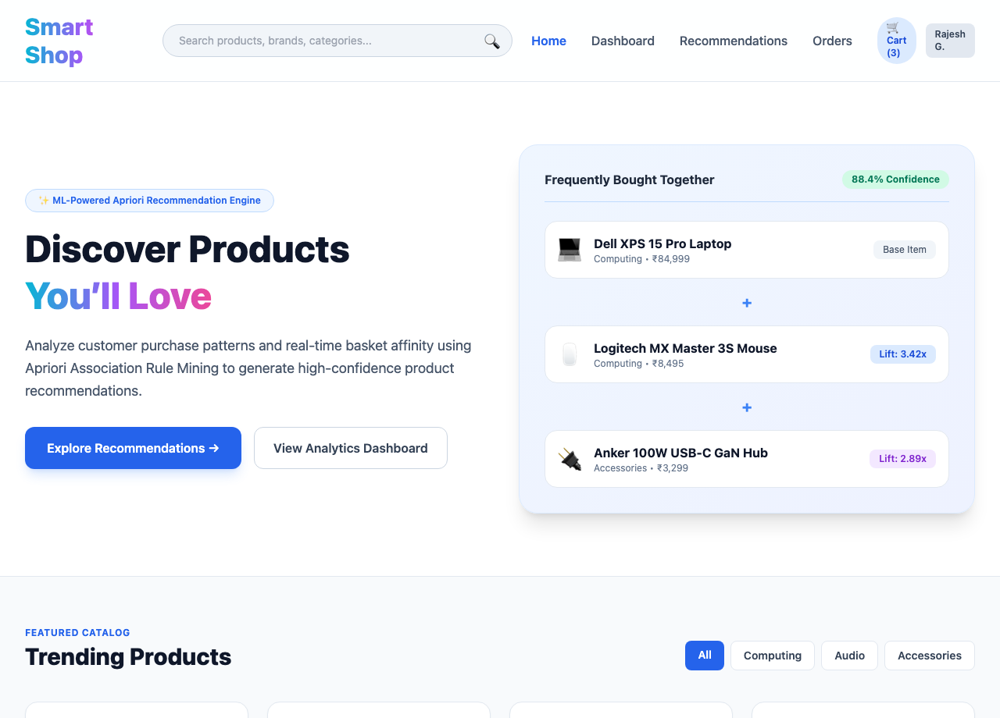

# RecoAI – E-Commerce Recommendation Engine (Association Rules) 🛍️

> Intelligent Full-Stack E-Commerce Recommendation Web Application powered by **React, TypeScript (Vite)**, **Flask**, **MongoDB**, and **Apriori Association Rule Mining (mlxtend)**.

---

## 🌟 Overview

**RecoAI** analyzes customer purchasing behavior and basket affinity in real-time. By applying the **Apriori Algorithm**, it identifies hidden product associations and generates dynamic recommendations (support, confidence, and lift) as shoppers browse and build their carts.

### Core Features
- **Smart Recommendations**: Real-time cross-sell suggestions based on mined association rules.
- **Analytics Dashboard**: Live metrics tracking catalog size, total transactions, active rules, and confidence ratings.
- **Modern React + Vite Frontend**: Fast, responsive UI with cart management, order history, and product details.
- **Flask REST API**: Modular Python backend handling authentication, rule mining, and transactional history.
- **MongoDB Database**: Document store for users, orders, and market basket transactions.

---

## 📸 Visual Previews

### 1. Smart Shop Storefront & Recommendation Engine


### 2. Analytics & Association Rule Mining Dashboard


---

## 📁 Project Structure

```
Group-Project/
├── README.md
├── docker-compose.yml
├── screenshots/
│   ├── group-project-ui.png
│   └── backend-api-health.png
├── frontend/ (or client/)        # React + TypeScript (Vite) SPA
│   ├── index.html
│   ├── vite.config.js
│   ├── package.json
│   ├── public/
│   └── src/
│       ├── components/          # ProductCard, RecommendationCard, Navbar, etc.
│       ├── pages/               # Landing, Dashboard, Cart, Orders, Admin
│       ├── context/             # AuthContext, CartContext
│       └── data/                # products.ts
└── backend/ (or server/)         # Flask + MongoDB REST API
    ├── app.py
    ├── requirements.txt
    ├── transactions.csv
    ├── .env.example
    ├── models/
    └── routes/
```

---

## 🚀 How to Run

### 1. Database (MongoDB)
Start local MongoDB using Docker:
```bash
cd Group-Project
docker compose up -d
```
*Defaults to `mongodb://localhost:27017` with database `recoai`.*

### 2. Backend API (Flask)
```bash
cd Group-Project/backend
python3 -m venv .venv
source .venv/bin/activate
pip install -r requirements.txt
python app.py
```
*Backend runs on `http://127.0.0.1:5000`.*

### 3. Frontend Client (Vite + React)
```bash
cd Group-Project/frontend
npm install
npm run dev
```
*Frontend runs on `http://localhost:5173`.*

---

## 👤 Author & Team
- **Rajesh Gorika** - [@rajeshgorika](https://github.com/rajeshgorika)
